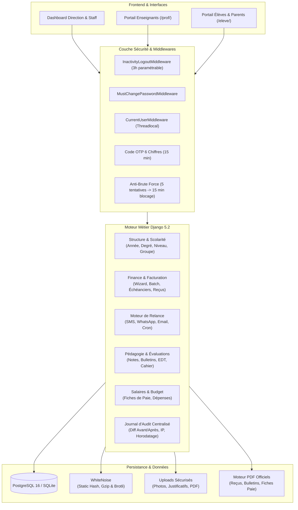

<div align="center">

# 🎓 SchoolERP Pro
### Système Intégré de Gestion Scolaire, Pédagogique, Financière & Ressources Humaines
**Solution ERP Clé en Main & Marque Blanche pour Établissements d'Enseignement**


<br>

**Une plateforme web moderne, hautement sécurisée et modulaire pour administrer à 360° les écoles privées et groupes scolaires (Maternelle, Primaire, Collège, Lycée).**

<br>

[🌐 Profil du Concepteur](https://www.linkedin.com/in/el-mehdi-bougrin) • [📖 Table des Matières](#-table-des-matières) • [🚀 Prise en Main](#-installation--mise-en-route) • [📋 Fonctionnalités Métier](#-modules--fonctionnalités-détaillées) • [🛠️ Déploiement VPS](#-guide-de-déploiement-production-vps)

</div>

---

## 📑 Table des Matières

- [📌 À Propos de la Solution & Vision Métier](#-à-propos-de-la-solution--vision-métier)
- [🏗️ Architecture Globale & Flux](#️-architecture-globale--flux)
- [👥 Matrice des Rôles & Espaces Dédiés](#-matrice-des-rôles--espaces-dédiés)
- [✨ Modules & Fonctionnalités Détaillées](#-modules--fonctionnalités-détaillées)
  - [1. Structure Scolaire & Référentiel](#1-structure-scolaire--référentiel)
  - [2. Gestion des Élèves, Inscriptions & Fratries](#2-gestion-des-élèves-inscriptions--fratries)
  - [3. Finance, Facturation & Assistant de Transaction (Wizard)](#3-finance-facturation--assistant-de-transaction-wizard)
  - [4. Recouvrement Intelligent & Relances Automatiques](#4-recouvrement-intelligent--relances-automatiques)
  - [5. Dépenses, Gestion des Salaires & Budget Prévisionnel](#5-dépenses-gestion-des-salaires--budget-prévisionnel)
  - [6. Transport Scolaire](#6-transport-scolaire)
  - [7. Pédagogie, Évaluations & Bulletins Trimestriels](#7-pédagogie-évaluations--bulletins-trimestriels)
  - [8. Emplois du Temps & Corps Enseignant](#8-emplois-du-temps--corps-enseignant)
  - [9. Vie Scolaire, Absences & Feuille d'Appel Numérique](#9-vie-scolaire-absences--feuille-dappel-numérique)
  - [10. Cahier de Texte & Ressources Numériques](#10-cahier-de-texte--ressources-numériques)
  - [11. Communication, SMS & Centre de Notifications](#11-communication-sms--centre-de-notifications)
  - [12. Sécurité Avancée, Profils & Journal d'Audit](#12-sécurité-avancée-profils--journal-daudit)
  - [13. Pages Institutionnelles & Conformité CNDP](#13-pages-institutionnelles--conformité-cndp)
- [📁 Arborescence du Projet](#-arborescence-du-projet)
- [🛠️ Stack Technologique & Dépendances](#️-stack-technologique--dépendances)
- [🚀 Installation & Mise en Route](#-installation--mise-en-route)
- [⚙️ Configuration d'Environnement (.env)](#️-configuration-denvironnement-env)
- [💻 Commandes Spécifiques de Gestion (manage.py)](#-commandes-spécifiques-de-gestion-managepy)
- [🚢 Guide de Déploiement Production (VPS)](#-guide-de-déploiement-production-vps)
- [🔒 Sécurité, Protection des Données & Loi 09-08](#-sécurité-protection-des-données--loi-09-08)
- [👤 Auteur & Conception](#-auteur--conception)

---

## 📌 À Propos de la Solution & Vision Métier

**SchoolERP Pro** est une suite logicielle intégrée d'administration scolaire et de pilotage académique, conçue pour unifier l'ensemble des opérations d'un établissement d'enseignement moderne :

1. **Direction & Gouvernance** : Tableaux de bord stratégiques en temps réel, indicateurs de rentabilité, budget prévisionnel et traçabilité absolue des opérations.
2. **Gestion Financière & Recouvrement** : Échéanciers automatisés sur 10 mois, assistant de règlement multi-modes (*Transaction Wizard*), reçus officiels imprimables et moteur de relance multicanal.
3. **Pôle Pédagogique & Vie Scolaire** : Feuille d'appel numérique instantanée, saisie des évaluations, calcul automatisé des moyennes, bulletins scolaires officiels et cahier de texte.
4. **Familles & Élèves** : Portails dédiés permettant la consultation en direct des résultats, du calendrier, des devoirs, des retards/absences et de la situation financière.

> **Architecture Marque Blanche (White-Label)** : L'application a été pensée pour être personnalisée selon l'identité graphique, le logo et les tarifs de n'importe quel établissement partenaire.

---

## 🏗️ Architecture Globale & Flux

Le système repose sur le framework Django en architecture MVT découplée, intégrant des couches de services, des signaux d'audit automatiques et des tâches asynchrones.



---

## 👥 Matrice des Rôles & Espaces Dédiés

Le système implémente un contrôle d'accès basé sur les rôles (RBAC) dynamique :

| Rôle | URL d'accès | Périmètre & Responsabilités |
| :--- | :--- | :--- |
| **Super Administrateur** | `/core/dashboard/superadmin/` | Contrôle total, vue financière consolidée, logs d'audit, gestion des rôles, budget prévisionnel, configuration SMS/SMTP. |
| **Direction / Admin** | `/core/dashboard/admin/` | Gestion des années scolaires, classes, élèves, inscriptions, personnel enseignant, validations des dépenses. |
| **Scolarité / Staff** | `/core/dashboard/staff/` | Inscriptions quotidiennes, saisie des absences, édition des listes, communication et avis scolaires. |
| **Comptable / Caisse** | `/core/finance/dashboard/` | Assistant de transaction (*Wizard*), encaissements espèces/chèques/virements, gestion des impayés, fiches de paie. |
| **Enseignant** | `/prof/` | Appel numérique en classe, saisie des notes par évaluation, consultation de l'emploi du temps, cahier de texte, résumés de cours. |
| **Élève / Parent** | `/eleve/` | Consultation des notes, relevés d'absences, bulletins scolaires téléchargeables, échéancier de paiement, cahier de texte. |

---

## ✨ Modules & Fonctionnalités Détaillées

### 1. Structure Scolaire & Référentiel
- **Années Scolaires** :
  - Gestion multi-années avec garantie stricte d'**une seule année active** simultanée grâce aux contraintes Django `UniqueConstraint(condition=Q(is_active=True))`.
  - Basculement d'année en un clic avec adaptation dynamique des formulaires et tableaux de bord.
- **Arborescence Académique** :
  - **Degrés** : Maternelle, Primaire, Collège, Lycée.
  - **Niveaux** : Niveaux d'enseignement (ex: PS, MS, GS, CP, CE1... 2ème BAC) avec définition des frais de scolarité par défaut.
  - **Groupes / Classes** : Définition des capacités maximales, professeurs principaux assignés, année de rattachement.
- **Périodes d'Évaluation** : Trimestres ou Semestres avec dates de début et de fin.

---

### 2. Gestion des Élèves, Inscriptions & Fratries
- **Fiche Élève 360°** :
  - Matricule unique attribué automatiquement.
  - Photo d'identité avec visionneuse grand écran (*Lightbox zoom*).
  - Coordonnées complètes, date de naissance, dossier médical et remarques confidentielles.
- **Processus d'Inscription & Réinscription** :
  - **Inscription Simple** : Pour un élève déjà répertorié.
  - **Inscription Full** : Création conjointe en une seule étape de l'élève, du parent tuteur, de l'inscription académique et de la première transaction financière.
  - **Réinscription Express** : Modale interactive pour renouveler l'inscription vers la nouvelle année active sans ressaisie des données civiles.
- **Détection Intelligente des Fratries** :
  - Liaison dynamique des élèves ayant les mêmes parents.
  - Application de remises familiales et paiement groupé multi-enfants dans le module financier.
- **Imports & Exports** :
  - Export et Import massif Excel (`.xlsx`) des listes d'élèves et de parents.
  - Génération de listes de classe officielles en PDF.

---

### 3. Finance, Facturation & Assistant de Transaction (Wizard)
- **Assistant de Règlement (*Transaction Wizard*)** :
  - Encaissement ultra-rapide mono ou multi-élèves (idéal pour les fratries).
  - Sélection interactive des échéances dues parmi l'échéancier annuel de 10 mois.
  - Support complet des modes de paiement :
    - 💵 **Espèces**
    - 🏦 **Chèque** (banque émettrice, numéro de chèque, date d'échéance/encaissement)
    - 📲 **Virement bancaire** (référence bancaire)
  - Pièces justificatives scannées attachables directement à la transaction.
- **Échéanciers Automatiques sur 10 Mois** :
  - Génération automatique des 10 mensualités de scolarité dès l'inscription.
  - Possibilité de personnaliser le tarif mensuel par élève (bourses, réductions spéciales).
- **Reçus Officiels Imprimables** :
  - Reçu de paiement professionnel au format PDF sécurisé avec numérotation unique séquentielle par année scolaire via `RecuCounter`.
  - Reçus individuels ou reçus groupés (*Batch Receipt*) avec récapitulatif détaillé par ligne de versement.
- **Gestion des Remboursements & Annulations** :
  - Module dédié de remboursement total ou partiel avec traçabilité du motif et contre-passation comptable.

---

### 4. Recouvrement Intelligent & Relances Automatiques
- **Détection Automatique des Retards** :
  - Tableau de bord en temps réel des impayés mensuels avec filtres par niveau, groupe et mois de retard.
  - Export Excel complet des impayés pour la comptabilité.
- **Moteur de Règles de Relance (`relance_auto`)** :
  - Initialisation de règles paramétrables par niveau d'urgence :
    - **J+3 après échéance** : Premier rappel courtois.
    - **J+7 après échéance** : Deuxième relance formelle.
    - **J+15 après échéance** : Relance urgente.
    - **J+30 après échéance** : Dernier avis avant contentieux.
- **Canaux de Diffusion Multiples** :
  - 💬 **WhatsApp** : Liens directs préformatés avec message personnalisé.
  - 📱 **SMS** : Envoi direct via passerelle SMS (Twilio / Webhooks intégrés).
  - ✉️ **Email** : Envoi de courriels au design soigné.
  - Remplacement automatique des balises (`{eleve}`, `{groupe}`, `{montant}`, `{mois}`).
- **Historique & Traçabilité des Relances** :
  - Journal complet des relances effectuées (`RelanceLog`) avec horodatage, canal et destinataire.

---

### 5. Dépenses, Gestion des Salaires & Budget Prévisionnel
- **Dépenses de l'Établissement** :
  - Classification par catégories (Fournitures, Énergie & Eau, Loyer, Maintenance, Informatique, etc.).
  - Saisie de la date, du montant, du fournisseur et pièce justificative (facture scannée/PDF).
- **Gestion des Fiches de Paie & Salaires (`FichePaie`)** :
  - Gestion du personnel enseignant et administratif (Staff).
  - Calcul dynamique : `Net à payer = Salaire de base + Primes - Déductions`.
  - Suivi des statuts (*À payer*, *Payé*) et du mode de versement (Virement, Chèque, Espèces).
  - Génération et impression du reçu de salaire / fiche de paie officielle en PDF.
- **Budget Annuel Prévisionnel (`BudgetAnnuel`)** :
  - Allocation budgétaire par catégorie pour chaque année scolaire.
  - Vue d'ensemble du budget comparant le prévisionnel aux dépenses réelles avec jauges de consommation.

---

### 6. Transport Scolaire
- **Activation & Gestion du Service** :
  - Souscription individuelle par élève au transport scolaire.
  - Définition du tarif mensuel spécifique.
- **Échéancier de Transport Dédié** :
  - Échéancier mensuel synchronisé avec le module de transaction et d'encaissement.

---

### 7. Pédagogie, Évaluations & Bulletins Trimestriels
- **Gestion des Matières** :
  - Définition des matières par niveau avec attribution de coefficients.
- **Évaluations & Contrôles** :
  - Création des évaluations (Contrôle continu, Devoir surveillé, Activité pratique, Examen).
  - Saisie rapide des notes sur grille interactive avec calcul automatique de la moyenne de la classe.
- **Bulletins de Notes Officiels** :
  - Vue détaillée du bulletin de l'élève par période avec notes, coefficients, moyennes et appréciations.
  - Export PDF prêt à l'impression, intégrant l'en-tête de l'établissement, le cachet et le relevé des absences de la période.

---

### 8. Emplois du Temps & Corps Enseignant
- **Fiches Enseignants** :
  - Données civiles, spécialités, coordonnées, statut d'activité.
- **Affectations Pédagogiques** :
  - Liaison des enseignants aux groupes et matières associées.
- **Séances de Cours & Emploi du Temps** :
  - Planification des créneaux horaires hebdomadaires (jour, heure de début, heure de fin, salle).
  - Grille hebdomadaire interactive :
    - Vue par Groupe / Classe.
    - Vue individuelle par Enseignant (`/core/edt-prof/`).

---

### 9. Vie Scolaire, Absences & Feuille d'Appel Numérique
- **Feuille d'Appel Numérique Temps Réel** :
  - Interface dédiée pour les enseignants ou surveillants avec chargement dynamique AJAX des élèves par séance.
  - Qualification immédiate : *Présent*, *Absent*, *En retard*, *Justifié*, *Non justifié*.
- **Absences des Enseignants** :
  - Enregistrement des motifs d'absence des professeurs et affectation éventuelle d'un remplaçant.
- **Rapports & Statistiques** :
  - Bilan journalier des absences avec export PDF en un clic (`/core/absences/jour/pdf/`).

---

### 10. Cahier de Texte & Ressources Numériques
- **Cahier de Texte Numérique** :
  - Remplissage par les enseignants du contenu de la séance dispensée et des devoirs à faire pour les prochaines séances.
  - Consultation directe par les élèves et leurs parents depuis leur portail.
- **Résumés de Cours & Supports PDF** :
  - Dépôt de supports de révision, polycopiés et résumés au format PDF.
  - Téléchargement sécurisé par les élèves du groupe concerné.

---

### 11. Communication, SMS & Centre de Notifications
- **Avis & Circulaires Scolaires** :
  - Publication d'annonces officielles avec pièces jointes et ciblage (Général, Groupes cibles).
- **Passerelle SMS Directe** :
  - Envoi unitaire ou par lot de messages courts aux parents avec suivi dans l'historique (`SmsHistorique`).
- **Centre de Notifications Multicanal** :
  - Boîte de réception interne (*Inbox*) avec système de marquage lu/non-lu.
  - Compteur de badges interactif dans le header via API asynchrone (`/core/notifications/api/unread/`).

---

### 12. Sécurité Avancée, Profils & Journal d'Audit
- **Protection Contre la Force Brute** :
  - Suivi des échecs d'authentification (`UserSecurityProfile`).
  - Verrouillage automatique du compte pour 15 minutes après 5 tentatives infructueuses consécutives.
- **Réinitialisation Sécurisée par Code OTP à 6 Chiffres** :
  - Remplacement des liens de réinitialisation longs par un code OTP à 6 chiffres transmis par e-mail, valable **15 minutes**.
- **Gestion des Mots de Passe & Déconnexion d'Inactivité** :
  - `MustChangePasswordMiddleware` : Obligation pour les nouveaux utilisateurs de changer le mot de passe temporaire lors de la première connexion.
  - `InactivityLogoutMiddleware` : Déconnexion automatique de la session après 3 heures d'inactivité (configurable via `AZ_IDLE_TIMEOUT_SECONDS`).
- **Journal d'Audit Généralisé (`AuditLog`)** :
  - Traçabilité complète de chaque action (Création, Modification, Suppression).
  - Stockage du diff détaillé avant/après en JSON, de l'adresse IP cliente, de l'utilisateur responsable et de l'horodatage.
- **Durcissement Production (HTTPS / Security Headers)** :
  - HSTS (1 an), redirection SSL forcée, protection X-Frame-Options DENY, SameSite Lax sur les cookies de session et CSRF.

---

### 13. Pages Institutionnelles & Conformité CNDP
- **Centre d'Aide & FAQ (`/core/aide/`)** : Base de connaissances intégrée guidant les utilisateurs sur la prise en main des modules.
- **Politique de Confidentialité (`/core/confidentialite/`)** : Déclaration rédigée en conformité stricte avec la **Loi marocaine n° 09-08** relative à la protection des personnes physiques à l'égard du traitement des données à caractère personnel (agrément CNDP).
- **Conditions Générales d'Utilisation (`/core/conditions/`)** : Règles d'exploitation et d'intégrité de la plateforme.
- **Support & Contact (`/core/contact/`)** : Formulaire direct d'assistance technique et administrative.

---

## 📁 Arborescence du Projet

```text
school-erp/
├── accounts/                      # Authentification, Sécurité, Profils et OTP
│   ├── middleware.py             # InactivityLogout, MustChangePassword, CurrentUser
│   ├── models.py                 # PasswordResetToken (OTP), UserSecurityProfile
│   ├── views.py                  # Login, Logout, Réinitialisation OTP, Profil
│   └── urls.py                   # Routes /accounts/*
│
├── config/                        # Configuration Principale Django
│   ├── settings.py               # Paramètres (Env, Sécurité, DB, WhiteNoise, Logging)
│   ├── urls.py                   # Routeur principal & redirection intelligente
│   └── wsgi.py / asgi.py         # Interfaces serveurs WSGI/ASGI
│
├── core/                          # Module Métier Central
│   ├── management/commands/      # Commandes personnalisées manage.py
│   │   ├── seed_roles.py         # Initialisation des rôles RBAC
│   │   ├── seed_degres.py        # Initialisation Maternelle, Primaire, Collège, Lycée
│   │   ├── relance_init_defaults.py # Règles de relance par défaut
│   │   ├── relance_auto.py       # Moteur d'envoi automatique des relances (Cron)
│   │   └── reset_db.py           # Réinitialisation dev sécurisée
│   ├── models.py                 # Structure, Élèves, Inscriptions, Finance, Salaires
│   ├── models_audit.py           # Modèle du Journal d'Audit (AuditLog)
│   ├── models_notifications.py   # Modèle de Notifications multicanal
│   ├── models_relance.py         # Règles et logs de relance
│   ├── models_sms.py             # Modèles SMS et campagnes
│   ├── views.py                  # Vues principales de gestion administrative
│   ├── views_finance.py          # Assistant de Transaction (Wizard) & Échéanciers
│   ├── views_depenses.py         # Gestion des dépenses & catégories
│   ├── views_salaires.py         # Fiches de paie & salaires du personnel
│   ├── views_budget.py           # Tableau de bord budgétaire annuel
│   ├── views_prof.py             # Logique métier Enseignants
│   ├── views_eleve.py            # Logique métier Élèves / Parents
│   ├── views_audit.py            # Consultation du journal d'audit
│   ├── views_notifications.py    # Centre de messagerie interne
│   ├── views_info.py             # Pages légales (Aide, Confidentialité, CGU)
│   ├── pdf_utils.py              # Générateur PDF de reçus, bulletins et fiches
│   ├── audit_signals.py          # Enregistrement automatique des signaux d'audit
│   ├── urls.py                   # Routes /core/*
│   └── urls_eleve.py             # Routes dédiées /eleve/*
│
├── prof/                          # Espace Dédié Enseignants
│   ├── urls.py                   # Routes /prof/* (Appel, Notes, Cahier, Résumés)
│   └── apps.py                   # Configuration de l'application
│
├── static/                        # Ressources Statiques
│   ├── admin/                    # Feuilles de style de l'interface d'administration
│   ├── eleve/ & prof/            # Styles et scripts des portails spécialisés
│   ├── img/                      # Logos, favicons et identité visuelle
│   └── src/ & dist/              # Configuration Tailwind CSS compilée
│
├── staticfiles/                   # Actifs collectés par collectstatic (WhiteNoise)
├── media/                         # Dépôt des fichiers téléversés (Photos, PDF, Reçus)
├── templates/                     # Gabarits HTML Jinja/Django
│   ├── admin/                    # Vues d'administration, dashboards et listes
│   ├── accounts/                 # Vues de connexion et flux OTP
│   ├── prof/                     # Templates du portail enseignant
│   ├── eleve/                    # Templates du portail parent/élève
│   └── emails/                   # Templates d'e-mails HTML responsives
│
├── manage.py                      # Script de commande principal Django
├── package.json                   # Dépendances Tailwind CSS & PostCSS
├── postcss.config.js              # Configuration PostCSS
├── tailwind.config.js             # Configuration Tailwind CSS
└── .env                           # Variables de configuration locale/production
```

---

## 🛠️ Stack Technologique & Dépendances

| Catégorie | Technologie | Rôle dans l'Écosystème |
| :--- | :--- | :--- |
| **Langage** | Python 3.13 | Socle de programmation moderne et typé. |
| **Framework Web** | Django 5.2 | Architecture robuste, ORM puissant, sécurité native. |
| **Base de Données** | PostgreSQL 16 | Intégrité relationnelle, transactions ACID, contraintes strictes. |
| **Fichiers Statiques** | WhiteNoise | Compression gzip/brotli, gestion de cache avec hash de fichiers. |
| **Styles & UI** | Tailwind CSS 4 & Vanilla CSS | Design moderne, composants responsives, légèreté sans frameworks lourds. |
| **Génération PDF** | WeasyPrint / ReportLab | Impression haute précision des reçus officiels et bulletins de notes. |
| **Tableurs & Données** | OpenPyXL | Importation et exportation des données au format Microsoft Excel (`.xlsx`). |
| **Messagerie & Alertes** | SMTP Gmail & API Twilio | Envoi sécurisé des codes OTP et des relances SMS/WhatsApp. |

---

## 🚀 Installation & Mise en Route

### 1. Prérequis Système
- **Python 3.11+** (recommandé Python 3.13).
- **PostgreSQL 15+** (ou SQLite pour un test rapide en environnement local).
- **Node.js 18+** (requis uniquement si vous souhaitez compiler les classes Tailwind CSS).
- **Git** pour le clonage du code source.

---

### 2. Cloner le Projet
```bash
git clone https://github.com/votre-compte/school-erp.git
cd school-erp
```

---

### 3. Environnement Virtuel Python

#### Sous Windows (PowerShell) :
```powershell
python -m venv venv
.\venv\Scripts\Activate.ps1
```

#### Sous Linux / macOS :
```bash
python3 -m venv venv
source venv/bin/activate
```

---

### 4. Installer les Dépendances Python
```bash
pip install --upgrade pip
pip install -r requirements.txt
```
*(Si vous partez d'une installation vierge : `pip install django psycopg2-binary python-dotenv whitenoise reportlab openpyxl twilio`)*

---

### 5. Préparer le Fichier de Variables d'Environnement (.env)
Créez un fichier `.env` à la racine du projet :
```bash
cp .env.example .env   # Ou créez directement le fichier .env
```

---

### 6. Appliquer les Migrations de la Base de Données
```bash
python manage.py makemigrations
python manage.py migrate
```

---

### 7. Initialiser les Données Fondamentales (Seed Data)
Exécutez dans l'ordre les commandes de seed créées spécifiquement pour le projet :
```bash
# 1. Création des rôles RBAC (ADMIN, SCOLARITE, COMPTABLE, PROF)
python manage.py seed_roles

# 2. Création des 4 degrés fondamentaux (Maternelle, Primaire, Collège, Lycée)
python manage.py seed_degres

# 3. Initialisation des règles de relance automatique par défaut
python manage.py relance_init_defaults
```

---

### 8. Créer le Compte Super Administrateur
```bash
python manage.py createsuperuser
```

---

### 9. Compiler les Fichiers Statiques (Optionnel en Dev)
```bash
# Si modifications apportées à Tailwind CSS
npm install
npm run tailwind:build

# Rassemblement des fichiers statiques WhiteNoise
python manage.py collectstatic --noinput
```

---

### 10. Démarrer le Serveur de Développement
```bash
python manage.py runserver
```

🌐 Ouvrez ensuite votre navigateur sur : **[http://127.0.0.1:8000/](http://127.0.0.1:8000/)** (redirection automatique vers la mire de connexion `/accounts/login/`).

---

## ⚙️ Configuration d'Environnement (.env)

Voici l'ensemble des variables d'environnement prises en compte :

```env
# ==============================================================================
# CONFIGURATION PRINCIPALE DJANGO
# ==============================================================================
DJANGO_DEBUG=True
DJANGO_SECRET_KEY=votre_cle_secrete_ultra_securisee_a_changer
DJANGO_TIME_ZONE=Africa/Casablanca

# ==============================================================================
# BASE DE DONNÉES POSTGRESQL (En local ou sur VPS)
# ==============================================================================
DB_NAME=school_erp_db
DB_USER=postgres
DB_PASSWORD=votre_mot_de_passe_db
DB_HOST=127.0.0.1
DB_PORT=5432
DB_CONN_MAX_AGE=60

# ==============================================================================
# SÉCURITÉ DE SESSION & EXPIRATION
# ==============================================================================
# Durée d'inactivité avant déconnexion automatique (en secondes, ex: 10800 = 3h)
AZ_IDLE_TIMEOUT_SECONDS=10800

# ==============================================================================
# MESSAGERIE SMTP (Réinitialisation par Code OTP & Alertes)
# ==============================================================================
DJANGO_EMAIL_BACKEND=django.core.mail.backends.smtp.EmailBackend
EMAIL_HOST=smtp.gmail.com
EMAIL_PORT=587
EMAIL_USE_TLS=True
EMAIL_HOST_USER=votre.email@gmail.com
EMAIL_HOST_PASSWORD=votre_mot_de_passe_application_google
DEFAULT_FROM_EMAIL=Administration Scolaire <contact@votre-domaine.com>

# ==============================================================================
# PASSERELLE SMS / TWILIO (Optionnel)
# ==============================================================================
TWILIO_ACCOUNT_SID=votre_account_sid
TWILIO_AUTH_TOKEN=votre_auth_token
TWILIO_FROM=SCHOOLDEMO

# ==============================================================================
# PARAMÈTRES PRODUCTION (VPS / HTTPS)
# ==============================================================================
DJANGO_SECURE_SSL_REDIRECT=False
DJANGO_SESSION_COOKIE_SECURE=False
DJANGO_CSRF_COOKIE_SECURE=False
DJANGO_HSTS_SECONDS=31536000
```

---

## 💻 Commandes Spécifiques de Gestion (`manage.py`)

Le projet intègre plusieurs scripts de maintenance sur mesure :

| Commande | Rôle & Action |
| :--- | :--- |
| `python manage.py seed_roles` | Crée les groupes utilisateurs (`ADMIN`, `SCOLARITE`, `COMPTABLE`, `PROF`) et leur attribue automatiquement les permissions CRUD sur les modèles. |
| `python manage.py seed_degres` | Insère de manière idempotente les degrés : `MATERNELLE`, `PRIMAIRE`, `COLLEGE`, `LYCEE`. |
| `python manage.py relance_init_defaults` | Installe les règles types de relance (Impayés J+3, J+7, J+15, J+30, seuils d'absences, etc.). |
| `python manage.py relance_auto` | Exécute l'analyse des échéances et déclenche l'envoi des messages programmés (à planifier en tâche Cron quotidienne). |
| `python manage.py relancer_impayes_mensuels` | Relance ciblée sur les mensualités en retard pour l'année scolaire active. |
| `python manage.py reset_db` | *(Dev uniquement)* Purge et réinitialise la base de données avec confirmation explicite. |

---

## 🚢 Guide de Déploiement Production (VPS)

Pour déployer la solution sur un VPS Linux (Ubuntu / Debian, ex. Hostinger, DigitalOcean, OVH) :

### 1. Architecture de Production
- **Serveur Web / Reverse Proxy** : Nginx (gestion du certificat SSL, compression et routage).
- **Serveur d'Application WSGI** : Gunicorn supervisé par `systemd`.
- **Fichiers Statiques** : WhiteNoise avec cache optimisé (`WHITENOISE_MAX_AGE=31536000`).
- **Certificat SSL** : Let's Encrypt via Certbot.

### 2. Configuration Systemd (`/etc/systemd/system/school_erp.service`)
```ini
[Unit]
Description=Gunicorn daemon for SchoolERP
After=network.target

[Service]
User=www-data
Group=www-data
WorkingDirectory=/var/www/school_erp
ExecStart=/var/www/school_erp/venv/bin/gunicorn \
          --workers 3 \
          --bind unix:/var/www/school_erp/gunicorn.sock \
          config.wsgi:application

[Install]
WantedBy=multi-user.target
```

### 3. Configuration Nginx (`/etc/nginx/sites-available/ecole.votre-domaine.com`)
```nginx
server {
    server_name ecole.votre-domaine.com www.ecole.votre-domaine.com;

    client_max_body_size 25M;

    location /static/ {
        alias /var/www/school_erp/staticfiles/;
        expires 365d;
        access_log off;
    }

    location /media/ {
        alias /var/www/school_erp/media/;
        expires 30d;
    }

    location / {
        include proxy_params;
        proxy_pass http://unix:/var/www/school_erp/gunicorn.sock;
    }
}
```

### 4. Automatisation des Relances avec Cron
Pour exécuter les relances automatiques chaque matin à **08h30** :
```bash
crontab -e
```
Ajoutez la ligne suivante :
```cron
30 8 * * * /var/www/school_erp/venv/bin/python /var/www/school_erp/manage.py relance_auto >> /var/log/school_relances.log 2>&1
```

---

## 🔒 Sécurité, Protection des Données & Loi 09-08

La plateforme intègre des mesures techniques et organisationnelles conformes aux standards de l'ANRT et de la **CNDP** (Commission Nationale de contrôle de la protection des Données à caractère Personnel - Maroc) :

1. **Sécurisation des Accès** :
   - Mots de passe hashés avec PBKDF2 et sel cryptographique.
   - Forçage de complexité minimale.
   - Code OTP 6 chiffres à validité éphémère (15 minutes).
   - Verrouillage temporaire après 5 échecs consécutifs.
2. **Audit & Non-Répudiation** :
   - Traçabilité intégrale via `AuditLog` : horodatage, utilisateur auteur, adresse IP et historique précis des valeurs modifiées (*diff JSON*).
3. **Respect de la Loi 09-08** :
   - Les données des élèves et de leurs tuteurs sont traitées exclusivement pour les finalités scolaires et comptables.
   - Droit d'accès, de rectification et d'opposition garanti via la page `/core/confidentialite/` et le formulaire de contact dédié.

---

## 👤 Auteur & Conception

Ce projet a été conçu, architecturé et développé par :

<div align="center">

### **El Mehdi Bougrin**
*Ingénieur Logiciel & Développeur Full Stack*

[](https://www.linkedin.com/in/el-mehdi-bougrin)
[](https://github.com/elmhaydy)

</div>

---

<div align="center">

© 2026 **El Mehdi Bougrin**. Tous droits réservés.  
*Solution logicielle sous licence propriétaire exclusive (Marque Blanche / SaaS).*

</div>
